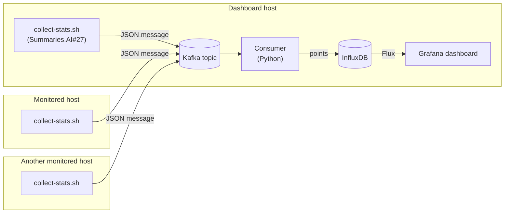

# Docker Stats Grafana

Collects the CPU, memory, network, disk and process figures of every Docker container on one or
more hosts, and shows them all in one Grafana dashboard. Each monitored host runs a script that
publishes its `docker stats` output to a Kafka broker. One host, the dashboard host, runs the rest
of the pipeline: a Python consumer that stores the figures in InfluxDB, and Grafana, which draws
them. In production the dashboard host is an EC2 instance; for development, the whole pipeline
runs on one machine with Docker Compose.

**Contents:** [Overview](#overview) · [Tech stack](#tech-stack) · [Architecture](#architecture) ·
[Getting started](#getting-started) · [Scripts](#scripts) · [Details](#details) ·
[License](#license)

## Overview

- Each monitored host sends the figures of its running containers every 10 seconds (adjustable).
- A dashboard of charts shows CPU, memory (percent and bytes), network traffic, disk traffic
  and process count per container over the last 15 minutes, refreshed every 5 seconds.
- A Host selector at the top of the dashboard narrows the charts to one or several hosts.
- A monitored host needs to reach only the Kafka broker, never InfluxDB or Grafana.
- The whole stack starts on a developer machine with one command, a local broker included.
- Stored figures are kept for 30 days.

## Tech stack

- **Producer:** bash, `docker stats` and `jq`, publishing through the first Kafka client found:
  `rpk`, `kcat`, `kafkacat`, `rpk` inside a local Redpanda container, or a Kafka container.
- **Broker:** any Kafka-compatible broker; Redpanda v26.2 locally.
- **Consumer:** Python 3.13, `kafka-python`, `influxdb-client`.
- **Storage:** InfluxDB 2.7.
- **Dashboard:** Grafana 10.2, provisioned from files, queries in Flux.
- **Runtime:** Docker Compose.
- **Quality gate:** pytest, ruff, mypy and `bash -n`, run by GitHub Actions on every push.

## Architecture

A producer script on each host publishes one JSON message per cycle, naming the host, to a Kafka
topic; hosts may share a topic. One consumer reads up to two topics, converts docker's text
columns into numbers and writes a point per container to InfluxDB, committing each message only
after its points are stored, so a failed write is read again after a restart. Grafana queries
InfluxDB.



Each box is a separate machine; the dashboard host may watch its own containers too.

Architecture continues from here: [docs/architecture.md](docs/architecture.md).

## Getting started

### Monitor an EC2 host

The deployed pipeline runs on one EC2 instance, the account's ECS host: its user data, kept in
another repository, starts the broker, the consumer image this repo publishes, InfluxDB and
Grafana with Docker Compose, and downloads the dashboard files from this repo's `main` branch.
Grafana listens on port 3100 of that host. Every monitored host publishes to its broker, so all
hosts share one dashboard and its Host selector tells them apart.

To add a host, such as a new EC2 that runs another app, run these on that host, by hand or from
its user data; nothing changes on the dashboard host:

1. Install `docker`, `jq` and `git`, plus `rpk` or `kcat` as the Kafka client.
2. Clone this repo and write its `.env` with two keys: `KAFKA_BOOTSTRAP_SERVERS` set to
   `<dashboard host's public DNS name>:19092` and `KAFKA_TOPIC_1` set to the topic the deployed
   consumer reads, `docker-stats-ecs-kafka`.
3. Run `./scripts/collect-stats.sh --host <name>` so it outlives the session: `nohup … &` in the
   user data, or a systemd service. The name is what the Host selector shows.
4. Let the host reach port 19092 of the dashboard host.

The host's containers appear in the dashboard after the first cycle. A developer machine takes
part only to change the pipeline: `build-push-consumer.sh` publishes a new consumer image, and a
dashboard change pushed to `main` reaches a dashboard host at its first boot.

### Run the stack locally

Requires Docker with the Compose plugin, `jq`, `curl` and `openssl`; the tests also need Python
3.13.

```bash
./scripts/init-env.sh        # create .env with generated credentials
./scripts/start.sh           # start the stack; returns once Grafana answers
./scripts/collect-stats.sh   # publish this machine's container stats until Ctrl+C
```

Open http://localhost:3100 and sign in as `admin` with `GRAFANA_ADMIN_PASSWORD` of `.env`. Every
port is published on the loopback interface only, so the local broker serves this machine alone.

- **Another host:** run `collect-stats.sh` from a checkout on that host whose `.env` names a
  broker the host can reach in `KAFKA_BOOTSTRAP_SERVERS`.
- **A broker elsewhere:** set `KAFKA_BOOTSTRAP_SERVERS` to an address the consumer container can
  reach (not `localhost`) and start with `./scripts/start.sh --no-kafka`.
- **Credentials:** InfluxDB applies those of `.env` only when its volume is first created; after
  changing them, run `./scripts/docker-helper.sh --stop --volumes`, which deletes stored points.

## Scripts

Each script prints its full documentation with `--help`.

- `scripts/init-env.sh`: create `.env` from `.env.example` with generated credentials.
- `scripts/start.sh [--no-kafka]`: build and start the stack, with or without a local broker.
- `scripts/docker-helper.sh --stop | --logs | --ps`: stop the stack (volumes kept unless
  `--volumes`), follow its logs, show its status.
- `scripts/collect-stats.sh`: publish this machine's docker stats to the broker.
- `scripts/build-push-consumer.sh [VERSION]`: build the consumer image (`linux/arm64` by
  default) and push it to Docker Hub for the deployed consumer.
- `scripts/test.sh`: the quality gate.

## Details

- [docs/architecture.md](docs/architecture.md): the parts, the message, the stored data, the
  delivery guarantee, the configuration, the codebase by directory.
- [docs/development.md](docs/development.md): local setup, tests, a remote broker, gotchas,
  troubleshooting.
- [docs/adr/](docs/adr/): why Kafka, InfluxDB, Docker Compose and file-provisioned Grafana;
  the message contract and the delivery guarantee.

## License

Released under the MIT License. See [LICENSE](LICENSE).
