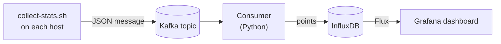

# Docker Stats Grafana

Shows the CPU, memory, network, disk and process figures of every Docker container on one or
more hosts in a Grafana dashboard. Each host publishes its `docker stats` output to a Kafka
topic; a Python consumer stores the figures in InfluxDB, and Grafana draws them.

## Overview

- Each monitored host sends the figures of its running containers every few seconds.
- A dashboard of six charts shows CPU, memory (percent and bytes), network traffic, disk
  traffic and process count per container, refreshed every 5 seconds.
- A Host selector at the top of the dashboard narrows the charts to one or several hosts.
- A host that cannot reach the stack directly only needs to reach the Kafka broker.
- The whole stack starts on a developer machine with one command, a local broker included.

## Tech stack

- **Producer:** bash, `docker stats`, `jq`, and one of `rpk`, `kcat` or a Kafka container.
- **Broker:** any Kafka-compatible broker; Redpanda v26.2 locally.
- **Consumer:** Python 3.13, `kafka-python`, `influxdb-client`.
- **Storage:** InfluxDB 2.7.
- **Dashboard:** Grafana 10.2, provisioned from files, queries in Flux.
- **Runtime:** Docker Compose.
- **Quality gate:** pytest, ruff, mypy and `bash -n`, run by GitHub Actions on every push.

## Architecture

A producer script on each host publishes one JSON message per cycle to a Kafka topic. One
consumer reads the topics, converts docker's text columns into numbers and writes a point per
container to InfluxDB. Grafana queries InfluxDB.



Architecture continues from here: [docs/architecture.md](docs/architecture.md).

## Getting started

Requires Docker with the Compose plugin, `jq`, `curl` and `openssl`.

```bash
./scripts/init-env.sh        # create .env with generated credentials
./scripts/start.sh           # start the stack; returns once Grafana answers
./scripts/collect-stats.sh   # publish this machine's container stats until Ctrl+C
```

Open http://localhost:3100 and sign in as `admin` with `GRAFANA_ADMIN_PASSWORD` of `.env`.

## Scripts

Each script prints its full documentation with `--help`.

- `scripts/init-env.sh`: create `.env` from `.env.example` with generated credentials.
- `scripts/start.sh [--no-kafka]`: build and start the stack, with or without a local broker.
- `scripts/docker-helper.sh --stop | --logs | --ps`: stop the stack (volumes kept unless
  `--volumes`), follow its logs, show its status.
- `scripts/collect-stats.sh`: publish this machine's docker stats to the broker.
- `scripts/build-push-consumer.sh [VERSION]`: build the consumer image and push it to Docker
  Hub.
- `scripts/test.sh`: the quality gate.

## Details

- [docs/architecture.md](docs/architecture.md): the parts, the message, the stored data, the
  delivery guarantee, the codebase by directory.
- [docs/development.md](docs/development.md): local setup, tests, a remote broker,
  troubleshooting.
- [docs/adr/](docs/adr/): the decisions behind the message contract and the delivery guarantee.

## License

Released under the MIT License. See [LICENSE](LICENSE).
