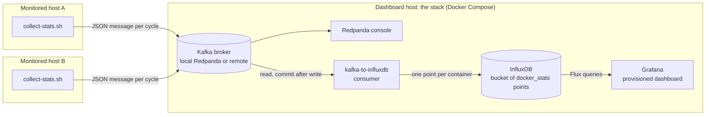

# Architecture

The detail behind the Architecture section of the [README](../README.md).

**Contents:** [Parts](#parts) · [The message](#the-message) · [Stored data](#stored-data) ·
[Delivery guarantee](#delivery-guarantee) · [Configuration](#configuration) ·
[The dashboard](#the-dashboard) · [Codebase](#codebase)



## Parts

- **Producer** (`scripts/collect-stats.sh`): runs on a monitored host. Every cycle it lists the
  running containers, leaves out those started less than 5 seconds ago (their figures are still
  zero or noise), takes one `docker stats` reading and publishes one message. It uses the first
  Kafka client it finds on the host; the script's header lists them and their cost. Hosts
  publish to a broker rather than write to InfluxDB, so a host needs to reach the broker alone
  and the broker holds messages while the consumer is down
  ([ADR 0003](adr/0003-kafka-between-hosts-and-stack.md)).
- **Broker**: any Kafka-compatible broker. `start.sh` runs a single-node Redpanda and its web
  console under the Compose profile `redpanda`; `--no-kafka` leaves them out for a broker that
  runs elsewhere. The stack runs in Docker Compose with every port on the loopback interface
  ([ADR 0005](adr/0005-docker-compose-stack.md)).
- **Consumer** (`consumer/`, service `kafka-to-influxdb`): reads up to two topics, converts each
  message and writes its points. `stats_message.py` holds the conversion and has no dependency
  outside the standard library; `consumer.py` holds the settings, the points and the loop.
- **InfluxDB**: stores the points, which are queried by time and never updated
  ([ADR 0004](adr/0004-influxdb-for-the-figures.md)). The organization, the bucket and the token
  are created on the first start from `.env`.
- **Grafana**: reads its datasource and its dashboard from `grafana/provisioning/` and opens on
  the dashboard, so every deployment that loads these files shows the same dashboard
  ([ADR 0006](adr/0006-grafana-provisioned-from-files.md)).

## The message

One JSON object per host per cycle:

```json
{
  "timestamp": "2026-11-10T18:11:05Z",
  "host": "ecs-kafka",
  "stats": [
    {"Container": "3f2a9c1d7b6e", "Name": "influxdb", "CPUPerc": "2.75%",
     "MemUsage": "50.87MiB / 1.803GiB", "MemPerc": "2.76%", "NetIO": "107MB / 766MB",
     "BlockIO": "38.4MB / 810MB", "PIDs": "14"}
  ]
}
```

- `host` names the machine; it becomes the `instance` tag. The topic plays no part in naming
  ([ADR 0002](adr/0002-host-name-in-the-message.md)).
- `timestamp` carries a UTC offset.
- Each entry of `stats` holds the columns of `docker stats` as docker prints them. An entry may
  hold more keys; the eight above are required.
- `stats` is empty for a host that runs no containers.
- An entry whose `CPUPerc` is `--` belongs to a container that stopped between the listing and
  the reading; the consumer leaves it out.

Sizes use docker's units: `B`, `kB`, `MB`, `GB`, `TB`, `PB` in powers of 1000 and `KiB`, `MiB`,
`GiB`, `TiB`, `PiB` in powers of 1024. Any other unit, a missing key or a value that does not
parse makes the whole message malformed.

## Stored data

Measurement `docker_stats`, one point per container per message, at the message's timestamp.
The bucket keeps points for 30 days.

- Tags: `instance` (the host), `container_id`, `container_name`.
- Fields: `cpu_percent`, `mem_percent`, `mem_used_bytes`, `mem_limit_bytes`, `net_rx_bytes`,
  `net_tx_bytes`, `block_read_bytes`, `block_write_bytes` (floats) and `pids` (integer).

The network and block fields are docker's running totals; the dashboard draws their rate of
change. Sums across containers are left to queries.

## Delivery guarantee

The consumer commits a message's offset only after InfluxDB has accepted its points
([ADR 0001](adr/0001-commit-after-write.md)).

- A write that fails ends the process with the message uncommitted. Docker restarts the
  container, and the consumer reads the message again. A point written twice has the same
  tags and timestamp, so it overwrites itself.
- The consumer does not tell an outage from a write InfluxDB will never accept, such as a
  field whose type differs from the stored one. Such a write restarts the consumer on the same
  message until an operator intervenes.
- A malformed message is logged with its topic, partition and offset and a count of rejections
  since the start, then committed, so it cannot block the messages behind it.
- A consumer group that has no committed offset starts at the newest message. Messages
  published before a group's first start are not read, and neither is a message whose write
  fails before the group's first commit.

## Configuration

`.env` at the repository root is the one place for settings; `.env.example` documents each key
and `init-env.sh` generates the credentials. `docker-compose.yml` hands each container the keys
it reads. The consumer and Grafana receive the same four InfluxDB values (`INFLUXDB_URL`,
`INFLUXDB_TOKEN`, `INFLUXDB_ORG`, `INFLUXDB_BUCKET`) from one block of the compose file. The
datasource file reads them from Grafana's environment, and the dashboard's queries use the
datasource's default bucket, so no file under `grafana/provisioning/` names a bucket or a token.

A deployment that takes the files under `grafana/provisioning/` without this compose file must
give its Grafana container those four variables.

The consumer stops at startup, naming the key, when a required setting is missing.

## The dashboard

`grafana/provisioning/dashboards/docker-stats.json`: time-series panels (CPU percent,
process count, memory percent, memory bytes, network rate, block I/O rate), the last 15 minutes,
refreshed every 5 seconds. The Host variable lists the values of the `instance` tag and filters
every panel; it allows several hosts and All.

## Codebase

- `consumer/`: the consumer's two modules, its tests, its pinned dependencies and its Dockerfile.
- `grafana/provisioning/`: the datasource, the dashboard provider and the dashboard.
- `scripts/`: every operational entry point; `common.sh` holds what they share.
- `docker-compose.yml`, `.env.example`: the stack and its settings.
- `.github/workflows/test.yml`: runs `scripts/test.sh` on every push and pull request.
- `docs/`: this page, [development.md](development.md) and the ADRs.
